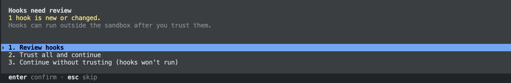
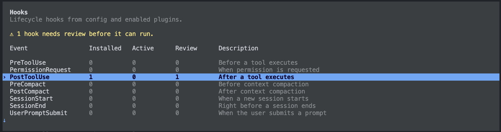

import { Aside, Badge, Card, CardGrid, LinkCard, Steps, Tabs, TabItem } from '@astrojs/starlight/components';

Fonn works inside the agent you already use. Install it once, add the hook for your agent, and keep running `claude`, `codex`, Crush, OpenCode or a desktop app on top of them. Command output gets shorter before the model reads it, and you manage filters and rules in `fonn ui`. You need Node 22 or later, and your agent set up and signed in as usual.

## 1. Install Fonn

<Tabs syncKey="fonn-install">
  <TabItem label="Homebrew" icon="rocket">

Homebrew runs on macOS.

<Steps>

1. Add the tap. It is this repository, so the full URL is needed.

   ```sh
   brew tap nord-forge/fonn https://github.com/nord-forge/fonn
   ```

2. Install the cask. It uses Homebrew's Node and fetches Fonn's locked dependencies on your machine, without `sudo`.

   ```sh
   brew install --cask nord-forge/fonn/fonn
   ```

</Steps>

Update later with `brew upgrade --cask nord-forge/fonn/fonn`. See [distribution](/reference/distribution/) for what the cask installs.

  </TabItem>
  <TabItem label="Source checkout" icon="github">

<Badge text="Newest features" variant="tip" />

<Steps>

1. Clone the repository and build it.

   ```sh
   git clone https://github.com/nord-forge/fonn.git
   cd fonn
   npm ci --ignore-scripts
   npm run build
   ```

2. Add a `fonn` alias. This prints the line for your shell profile, such as `~/.zshrc`:

   ```sh
   echo "alias fonn='node $PWD/packages/cli/dist/cli/main.js'"
   ```

3. Open a new terminal and check it works with `fonn --help`.

</Steps>

Update with `git pull`, then `npm ci --ignore-scripts && npm run build`. After moving the checkout, run `fonn hooks install` again so the hooks point at the new place. A hook installed from a source checkout runs that folder's current build in every session and project, so building, switching branches or unfinished changes there affect all of them. Fonn says so when you install it and in `fonn hooks`. If you work on Fonn itself, install the hook from Homebrew, or from a second clone that stays on `main`.

  </TabItem>
</Tabs>

## 2. Add the hook for your agent

Pick the agent you use. Fonn shows the change it will make to that agent's own settings file and asks before writing it. Your other settings and hooks stay as they are, and `fonn hooks uninstall` removes exactly what Fonn added.

<Tabs syncKey="agent">
  <TabItem label="Claude Code">

```sh
fonn hooks install --agent claude
```

Fonn adds one `PostToolUse` hook to `~/.claude/settings.json`. Start a new `claude` session and it applies, in every project.

Before writing, Fonn shows the plan and a diff of the file, and waits for your answer:

```text
Claude Code: ~/.claude/settings.json
  Add one PostToolUse hook for Bash to ~/.claude/settings.json that runs Fonn's filter.
  Other hooks and settings stay as they are.
  ...
      ]
+   },
+   "hooks": {
+     "PostToolUse": [
+       {
+         "matcher": "Bash",
+         "hooks": [
+           {
+             "type": "command",
+             "command": "'/opt/homebrew/bin/fonn' 'hook' '--agent' 'claude'",
+             "timeout": 5
+           }
+         ]
+       }
+     ]
    }
  ...

Install the Fonn hook for Claude Code? [y/N]
```

  </TabItem>
  <TabItem label="Codex">

```sh
fonn hooks install --agent codex
```

Fonn adds its hook to `~/.codex/hooks.json`, named `Fonn output filter`. Codex asks you to review and trust new hooks, and Fonn never trusts it on your behalf. The next time you start Codex, it says a hook is new:



Choose **Review hooks**, or run `/hooks` later. The list shows one `PostToolUse` hook waiting for review:



Open `PostToolUse`. The Fonn hook shows its matcher `Bash`, the source `~/.codex/hooks.json` and the command `'/opt/homebrew/bin/fonn' 'hook' '--agent' 'codex'` with a 5 second timeout. Press `t` to trust it. Codex runs it from then on, and asks again only when the hook changes.

  </TabItem>
  <TabItem label="Crush">

```sh
fonn hooks install --agent crush
```

Fonn adds a `PostToolUse` hook for the `bash` tool to `~/.config/crush/crushrc`. It works with any model Crush runs, including Ollama.

  </TabItem>
  <TabItem label="OpenCode">

```sh
fonn hooks install --agent opencode
```

Fonn adds a small plugin to `~/.config/opencode/plugins/`. It works with any model OpenCode runs, including Ollama.

  </TabItem>
  <TabItem label="A desktop app">

Desktop apps and editor extensions that run Claude Code or Codex underneath read the same user settings as the terminal. Install the hook for that agent, then restart the app:

```sh
fonn hooks install --agent claude
```

If the app runs its own agent instead, the hook does not reach it. `fonn hooks` shows what is installed.

  </TabItem>
</Tabs>

Use several agents? `fonn hooks install` without `--agent` offers the hook for every agent it finds. Check the result any time with `fonn hooks`.

## 3. Manage it in fonn ui

```sh
fonn ui
```

<CardGrid>
  <Card title="Agents" icon="puzzle">
    See which agents have the hook, update it after moving Fonn, or remove it.
  </Card>
  <Card title="Rules and filters" icon="setting">
    Paste a command's output and click the noisy lines to build a rule. Rules work for every project or for one, and project rules need your approval.
  </Card>
  <Card title="Test bench" icon="seti:shell">
    Paste a command's output and see exactly what the model would receive.
  </Card>
  <Card title="Activity" icon="list-format">
    Every hooked session, with what was shortened and the full originals.
  </Card>
</CardGrid>

<LinkCard title="The Fonn UI" description="Everything the local interface can do, and how it keeps your data on this machine." href="/reference/ui/" />

## Other ways

The hook is the easiest way for most people. These suit other needs.

<CardGrid>
  <Card title="Without installing Fonn" icon="document">
    Download the filter into one project and wire it into Claude Code, Codex, Crush or OpenCode yourself. [Filter only](#filter-only-without-installing-fonn)
  </Card>
  <Card title="Fonn's own launchers" icon="rocket">
    `fonn claude` and `fonn codex` start your agent with Fonn's settings, profiles and resume. `fonn chat` is a small agent for local models. [Launchers](#fonns-own-launchers)
  </Card>
</CardGrid>

### Filter only, without installing Fonn

<Badge text="No Fonn CLI" variant="note" />

Use only the filter with the Claude Code or Codex you already have. There is no npm install or SDK, just a handful of files in your project.

<Steps>

1. Download the files from your project's root.

   ```sh
   mkdir -p scripts/fonn-filter
   curl -fsSL https://codeload.github.com/nord-forge/fonn/tar.gz/main \
     | tar -xz -C scripts/fonn-filter --strip-components=3 fonn-main/standalone/filtering
   node scripts/fonn-filter/hook.mjs --help
   ```

   GitHub serves the repository as one small archive, and `tar` keeps only the filter folder.

2. Ask your agent to set up the hook. This prompt keeps your existing hooks and permissions, and leaves Codex hook trust to you.

   ```text wrap
   Read scripts/fonn-filter/*.mjs and its LICENSE. Configure this local filter for the agent I am using: merge a Bash PostToolUse hook into .claude/settings.local.json for Claude Code, or .codex/hooks.json for Codex. Use absolute, correctly quoted paths to Node, hook.mjs and this project's .fonn/filtering directory, with --provider claude or codex and --mode filter. Preserve all existing hooks, permissions and policies; change no global settings and install no CLI, npm packages or SDKs. Add .fonn/ to .gitignore if needed. Explain how to recover full originals using the footer's bounded read command. For Codex, leave the required /hooks review and trust to me; do not bypass it. Show the local changes and any manual step. Do not make model requests to test this.
   ```

3. For Codex, open `/hooks` and trust the Fonn hook. Claude Code picks it up at the next start.

</Steps>

The hook takes `--level strict|standard|similar`; see [filter levels](/filtering/levels/). The [local filtering guide](/reference/local-filtering/) has complete hook examples and shows how to pin the download to one reviewed commit.

### Ollama and open agents, without installing Fonn

<Badge text="No Claude or Codex needed" variant="tip" />

Run open models such as Qwen, Gemma or Kimi with [Ollama](https://ollama.com) and an open-source agent. The same filter plugs into the agent's own hook.

<Steps>

1. Start Ollama with a bigger context. On most laptops its default is 4,096 tokens, too small for an agent's instructions and tools. Ollama recommends at least 64k for coding agents.

   ```sh
   OLLAMA_CONTEXT_LENGTH=65536 ollama serve
   ollama pull qwen3.8:27b
   ```

2. Download the filter into your project. For OpenCode, use `.opencode/plugins` as the folder instead, so the plugin and the filter sit together.

   ```sh
   mkdir -p scripts/fonn-filter
   curl -fsSL https://codeload.github.com/nord-forge/fonn/tar.gz/main \
     | tar -xz -C scripts/fonn-filter --strip-components=3 fonn-main/standalone/filtering
   ```

3. Connect it to your agent. Each one takes a few lines of configuration:

   - **Crush**: a `PostToolUse` hook that runs `hook.mjs --provider crush`.
   - **OpenCode**: nothing more to copy when you downloaded into `.opencode/plugins`. The plugin finds `hook.mjs` beside it. A plugin on its own skips filtering without any error, unless `FONN_FILTER_HOOK` points at `hook.mjs`.
   - **Claude Code**: point it at Ollama's Anthropic API and use the normal Claude hook from [Filter only](#filter-only-without-installing-fonn).

</Steps>

<Aside type="tip" title="Or use Fonn's own agent">
`fonn chat --model qwen3.8:27b` is a small coding agent for open models with the filter built in. Its first request is under 1,000 tokens, so local models answer much sooner than in agents with large prompts. It asks before every command and file change. See [fonn chat](/reference/agent/).
</Aside>

<LinkCard title="Use the filter with Ollama and other agents" description="Exact configuration for Crush, OpenCode and Claude Code with Ollama, model tips and which agents cannot use the filter yet." href="/reference/other-agents/" />

### Fonn's own launchers

Instead of a hook, Fonn can start your agent for you. `fonn claude` and `fonn codex` launch it with a Fonn profile, the project's settings and `fonn resume`. `fonn chat --model qwen3.8:27b` is Fonn's own small agent for Ollama and LM Studio, with the filter built in. See [everyday use](/start/everyday-use/) and [fonn chat](/reference/agent/).

<Aside>
Installing from npm is not a supported distribution method today. A desktop app is planned, and none exists yet.
</Aside>
